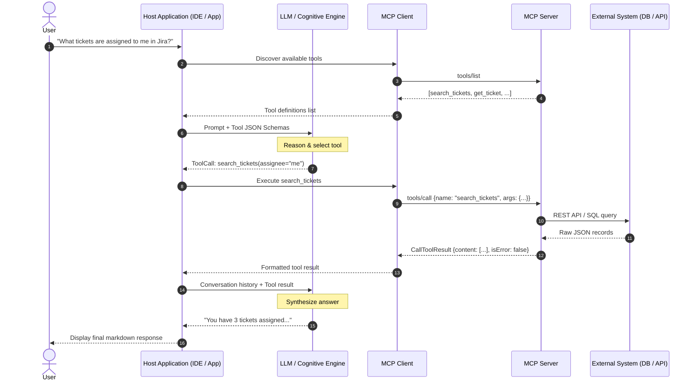
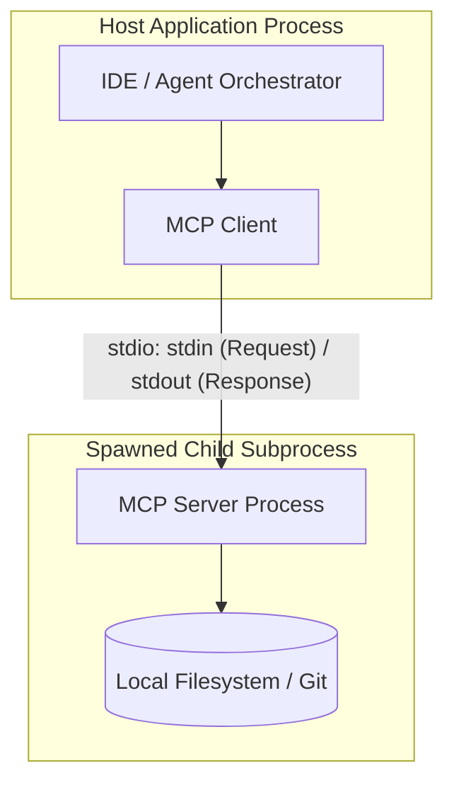
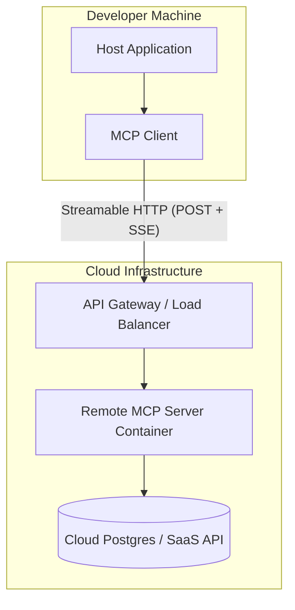

# Concepts: MCP Architecture & Deployment Topologies

## 1. The Full End-to-End Interaction Trace

An MCP system consists of six distinct participating entities. Trace how a single user question travels through the architecture:



---

## 2. Crucial Insight: The LLM Does NOT Speak MCP

A common beginner misconception is assuming the LLM opens TCP sockets or speaks JSON-RPC 2.0 directly.

**In reality:**
1. The **Model** only consumes text/tokens and outputs text/tokens (or structured JSON conforming to the provider's function-calling schema).
2. The **Host** orchestrates inference, injects tools into the prompt, and receives tool-calling choices.
3. The **MCP Client** (running inside the Host) translates that choice into a standardized MCP `tools/call` JSON-RPC message.
4. The **MCP Server** executes the tool and sends the result back across the transport.

---

## 3. The Three Deployment Topologies

### Topology 1: Local Subprocess (stdio)



- **Transport**: Standard OS anonymous pipes (`stdin` / `stdout`).
- **Lifecycle**: Child process spawned and terminated by the Host.
- **Security**: Local OS process isolation, inherited environment variables, file permissions.

---

### Topology 2: Remote Service (Streamable HTTP)



- **Transport**: HTTP POST for commands, Server-Sent Events (SSE) for streaming responses.
- **Lifecycle**: Long-running remote service / container.
- **Security**: TLS, OAuth 2.0 Bearer tokens, network firewalls.

---

### Topology 3: Multi-Server Host Aggregation

```mermaid
graph TD
    subgraph Host_App [IDE / Host Application]
        Orchestrator[Agent Orchestrator]
        C1[MCP Client 1]
        C2[MCP Client 2]
        C3[MCP Client 3]

        Orchestrator --> C1
        Orchestrator --> C2
        Orchestrator --> C3
    end

    subgraph S1 [Local File Server (stdio)]
        S1_Proc[File MCP Server]
    end

    subgraph S2 [GitHub Remote MCP (HTTP)]
        S2_Proc[GitHub Server]
    end

    subgraph S3 [Postgres Server (stdio)]
        S3_Proc[DB MCP Server]
    end

    C1 --> S1_Proc
    C2 --> S2_Proc
    C3 --> S3_Proc
```

- **Aggregation**: The Host manages multiple MCP Clients concurrently, combining tool definitions into a single unified tool catalog for the LLM.
- **Fault Isolation**: If Server 3 crashes, Server 1 and 2 continue operating without interruption.

---

## 4. Trust Boundaries & Credential Ownership

| Concept | Who Owns / Enforces It? |
|---|---|
| **User Approval & Consent** | **Host Application** (displays modal: "Allow tool `delete_database`?") |
| **API Credentials (OAuth / Keys)** | **MCP Server** (for remote backend access) OR **Host** (if passed per-request) |
| **Tool Execution Sandbox** | **MCP Server** (sandboxes shell / filesystem access) |
| **Input Validation** | **MCP Server** (validates parameters against JSON Schema before execution) |
| **Prompt Injection Defense** | **Host & Model** (sanitizes tool output before re-feeding to LLM context) |
