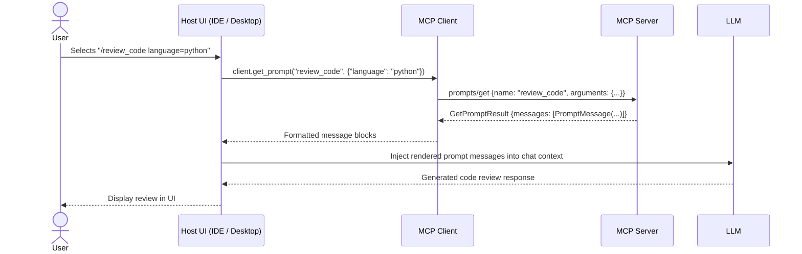

# Concepts: MCP Prompts & Workflow Templates

## 1. What is an MCP Prompt?

In the Model Context Protocol, a **Prompt** is a server-defined, reusable conversational template.

Unlike Tools (which the Model decides to call during reasoning), **Prompts are controlled by the Host Application or User**. They typically surface in AI host interfaces as slash commands (e.g., `/review-code`), template pickers, or predefined workflow buttons.

---

## 2. MCP Prompt vs. System Prompt vs. Prompt Engineering

| Concept | Who Controls It? | Where Does It Live? | Purpose |
|---|---|---|---|
| **Base System Prompt** | Host Application | Host / LLM API call | Establishes model persona, tool usage rules, safety boundaries. |
| **MCP Prompt** | **User / Host via Server** | **MCP Server** | Advertises domain-specific conversational templates with typed arguments. |
| **Prompt Engineering** | Developer / User | Text strings | Techniques for optimizing model responses (few-shot, chain-of-thought). |

---

## 3. The Lifecycle of an MCP Prompt



---

## 4. The Triad of Responsibilities: Resource + Prompt + Tool

A clean architecture separates capabilities across all three primitives:

```
┌─────────────────────────────────────────────────────────────────────────┐
│ 1. RESOURCE: Where is the data?                                         │
│ "repo://src/auth/jwt.py" (Raw file content)                             │
├─────────────────────────────────────────────────────────────────────────┤
│ 2. PROMPT: What should the model do with it?                            │
│ "security_audit(language='python')" (Auditing instructions template)    │
├─────────────────────────────────────────────────────────────────────────┤
│ 3. TOOL: How does the model apply changes?                              │
│ "apply_patch(file_path, diff)" (Executable write action)                │
└─────────────────────────────────────────────────────────────────────────┘
```
